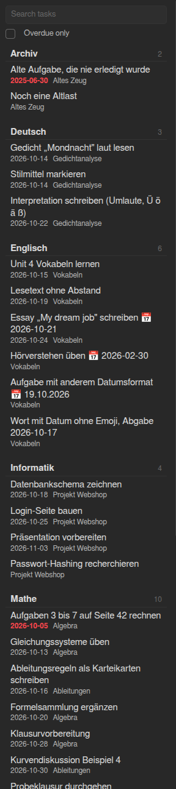

# Subject tasks

An [Obsidian](https://obsidian.md) plugin that shows the open tasks of your whole vault in one sidebar view, grouped by subject folder and sorted by due date.

I keep my school notes in one folder per subject, and my open tasks (`- [ ]`) end up scattered over dozens of notes. This plugin collects them in one place, so I can see what is due without opening every note.

> **Status: work in progress (version 0.1.0, not released yet).**
> Working today: the sidebar view, grouping, sorting, filters, jumping to the task, and the commands below.
> Not built yet: ticking a task from the view (the plugin currently never changes your notes), and a full settings screen (see [Settings](#settings)).

<p align="center">
  
</p>

## What it does

- **One list for the whole vault.** Open the view from the command palette and see every open task.
- **Grouped by subject.** A subject is the first folder below a root folder you choose. With no root folder set, it is the first folder in the note's path.
- **Sorted by urgency.** Overdue tasks come first, then tasks by due date (today included), then tasks without a date.
- **Overdue tasks stand out.** They get the CSS class `is-overdue` and a red date.
- **Click to jump.** Clicking a task opens its note with the cursor on that line. Hold <kbd>Ctrl</kbd>/<kbd>Cmd</kbd> or middle-click to open it in a new tab. If the note changed in the meantime, the plugin looks for the task's line instead of trusting the old line number.
- **Filters.** Search by words (all words must match the task text or the note path) and an "Overdue only" switch.
- **Always up to date.** Editing, renaming or deleting notes updates the list within a moment.

## Commands

| Command | What it does |
| --- | --- |
| Open view | Shows the task list in the right sidebar. |
| Refresh task index | Reads the vault again and shows how many tasks were found and how long it took. Normally not needed. |

The plugin sets no default hotkeys. You can assign your own under *Settings → Hotkeys*.

## How tasks are recognized

A task is a Markdown list item with a checkbox. Obsidian decides what counts as a task (this plugin asks Obsidian's own metadata cache), and the plugin then reads the details from that line.

| Written as | Recognized |
| --- | --- |
| `- [ ] text`, `* [ ] text`, `+ [ ] text` | yes |
| `1. [ ] text`, `1) [ ] text` | yes |
| Tasks nested in other lists | yes |
| Tasks inside quotes and callouts (`> - [ ] text`) | yes |
| `[x]` or `[X]` | done |
| Other characters, such as `[/]` or `[-]` | custom status |
| Inside code blocks or frontmatter | no |
| An empty `- [ ]` with no text, or `- [ ]text` | no (Obsidian does not treat these as tasks either) |

**Due date.** Write `📅 2026-10-20` anywhere in the task, the same format the [Tasks](https://github.com/obsidian-tasks-group/obsidian-tasks) plugin uses.

- The date must be real: `2026-02-30` is ignored and stays visible in the task text, so you can spot the typo.
- With several `📅` dates in one task, the last valid one counts.
- Other date formats and other emoji (such as ⏳ or ✅) are not read.

By default only open tasks are shown. Done tasks and tasks with a custom status appear only with the *Show completed tasks* option.

## Settings

| Setting | Default | Meaning |
| --- | --- | --- |
| Root folder | empty (whole vault) | The folder whose subfolders are the subjects. |
| Excluded folders | none | Notes in these folders are ignored. |
| Show completed tasks | off | Also list done tasks and tasks with a custom status. |

At the moment the settings screen offers only the root folder. *Excluded folders* and *Show completed tasks* are already stored in the plugin's `data.json` but get their settings controls in a later version.

## Installation

The plugin is not in the community plugin directory yet. To try it, build it yourself:

1. Close Obsidian's restricted mode (*Settings → Community plugins*).
2. Clone this repository into `<your vault>/.obsidian/plugins/subject-tasks`. The folder name must be `subject-tasks`.
3. Run `npm install` and `npm run build` in that folder.
4. Enable *Subject tasks* under *Settings → Community plugins*.

It needs Obsidian **1.7.2** or newer. It uses no Node or Electron APIs and is built to work on mobile, but I have not tested it there yet.

Try it in a separate test vault first, not in your real notes. The folder `test-vault-samples/` contains invented notes with the edge cases this plugin handles.

## Why another task plugin?

There are good task plugins already. If you want a lot of features, use one of them:

- [Taskgregator](https://community.obsidian.md/plugins/taskgregator) is a full task dashboard with priorities, smart lists and editing.
- [Sidebar Task Hub](https://github.com/kamil-bartczak/obsidian-sidebar-task-hub) lists tasks in the sidebar, grouped by folder, file and heading.
- [Tasks](https://github.com/obsidian-tasks-group/obsidian-tasks) can group by the top-level folder with `group by root`, but only inside query blocks in a note, not in a sidebar.

This plugin is deliberately small:

1. **School-shaped.** The subject is simply the first folder, with no setup beyond an optional root folder.
2. **One fixed order.** Overdue, then by date, then undated. There is nothing to configure or query.
3. **Notes stay the only source of truth.** There are no priorities, no recurring tasks, no query language, no database, no sync and no network access.
4. **Minimal changes to your notes.** The only thing it will ever write is the checkbox.
5. **Code you can read.** The parser and the sorting are plain functions with unit tests and no Obsidian dependency.

This comparison is based on the other plugins' documentation pages, not on long-term use. Details may have changed.

## Development

Node.js 20.19 or newer is recommended (a lint dependency asks for it). Build and tests also ran on Node 18.

```
npm install
npm run dev     # builds main.js and rebuilds on every change
npm run build   # type check and production build
npm test        # unit tests (Vitest)
npm run lint    # ESLint with the Obsidian plugin rules
```

For quick reloads in a test vault, install the [Hot Reload](https://github.com/pjeby/hot-reload) plugin and add an empty file named `.hotreload` to the plugin folder.

Project layout:

```
src/
  main.ts            wiring only: settings, commands, view registration
  parser/            task lines to tasks (pure functions, unit tested)
  model/             subjects, sorting, grouping, filtering (pure, unit tested)
  vault/taskIndex.ts keeps all tasks in memory and follows vault changes
  view/              the sidebar view
  settings/          settings and the settings tab
scripts/             generate a large fake vault, measure parsing outside Obsidian
test-vault-samples/  invented notes for trying the plugin in a test vault
```

Reading the whole vault is fast: in a generated vault of 2000 notes (about 5500 tasks), *Refresh task index* takes around 20 ms in Obsidian on a desktop PC. Generate your own with `node scripts/generate-vault.mjs <empty folder> 2000`.

## Privacy

Subject tasks reads the Markdown notes in your vault to find tasks. It makes no network requests, collects no data, and keeps nothing outside your vault except its own settings file.

## License

See [LICENSE](LICENSE).
